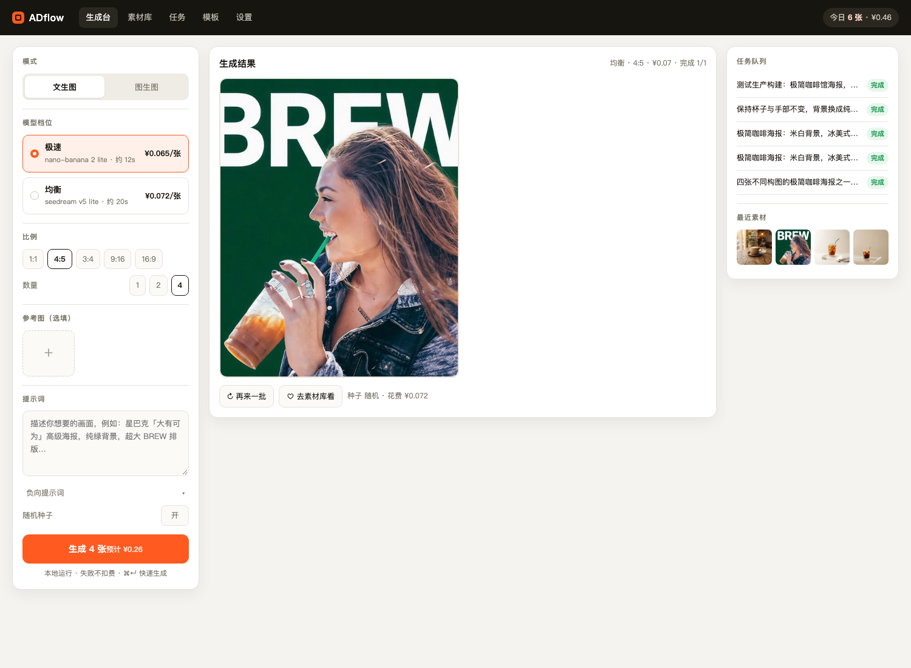

# ADflow

> 一个人的 AI 图片生产线：文生图 / 图生图 / 批量出图，本地跑，成本看得见。



基于 RunningHub OpenAPI（nano-banana / seedream）封装，Next.js + SQLite，数据全在本机。

---

## 现在能做什么

| 能力 | 状态 |
|---|---|
| 文生图 / 图生图（1–3 张参考图） | ✅ |
| Agnes 图像模型（文生图 / 图生图，2K） | ✅ |
| 视频生成（Agnes Video 2.5 Flash / 2.5） | ✅ |
| 一次出 1 / 2 / 4 张（上游一次一张，后台并发跑多个任务） | ✅ |
| 模型档位切换（极速 / 均衡） | ✅ |
| 比例 1:1 / 4:5 / 3:4 / 9:16 / 16:9 | ✅ |
| 异步队列、进度、失败重试 | ✅ |
| 图库：搜索、收藏、下载、删除 | ✅ |
| 素材库：裁剪成品（32:5 / 6:5）瀑布流 | ✅ |
| 模板：一键回填提示词与参数 | ✅ |
| 成本记录：单张 / 今日 / 本月 / 按模型 | ✅ |
| 素材详情：参数、复制提示词、下载、收藏、删除 | ✅ |
| 原图对比滑条（图生图） | ✅ |
| 预设管理（模型+比例+数量+提示词，一键回填） | ✅ |
| 区域重生成（画刷选区，裁剪重画后羽化贴回） | ✅ |
| 扩图（镜像延展画布 + 生成补全 + 原图回贴） | ✅ |

设计文档：[产品设计 v0.2](docs/PRODUCT-DESIGN.md) ｜ 线框图：[wireframe.html](docs/wireframe.html) ｜ 更新记录：[CHANGELOG](docs/CHANGELOG.md)

---

## 快速开始

要求 **Node ≥ 22.5**（用到内置 `node:sqlite`，本机实测 Node 24）。

```bash
pnpm install

# 配置上游密钥
cat > .env <<'EOF'
RUNNINGHUB_API_KEY=你的密钥
RUNNINGHUB_BASE_URL=https://www.runninghub.ai

# 可选：Agnes 图像模型（不填就不显示 Agnes 档位）
AGNES_URL=https://apihub.agnes-ai.com/v1
AGNES_KEY=你的 Agnes 密钥
# 国内站二选一：AGNES_BASE_URL / AGNES_API_KEY
EOF

pnpm dev          # http://127.0.0.1:3000
```

生产：

```bash
pnpm build && pnpm start
```

默认只监听 `127.0.0.1`，不对外暴露。

### Docker 部署

```bash
# 服务器上，目录里放好源码和 .env
docker compose build
docker compose up -d
```

- 对外端口：`3200`（容器内 3000），访问 `http://<服务器IP>:3200`。
- 数据持久化：`./data` 挂到容器 `/app/data`，SQLite、图片、缩略图、上传的参考图都在里面；备份时整目录拷走即可。
- `.env` 通过 `env_file` 注入，不打进镜像；至少要有 `RUNNINGHUB_API_KEY` 和 `RUNNINGHUB_BASE_URL`。
- 容器以 uid 1000 运行，`./data` 需对该用户可写；镜像自带健康检查（`/api/models`）。

---

## 使用

1. 打开 `/create`，写提示词（或点「快速开始」里的例子）。
2. 选档位、比例、数量，按钮上会显示这一批大概花多少钱。
3. 生成后可下载、收藏、再来一批；失败任务会在队列里标红，可重试。
4. `/library` 按提示词搜索、收藏、删除；`/tasks` 看所有历史；`/settings` 调汇率、预算、并发。

图生图：点「图生图」或直接拖图到参考图槽位，最多 3 张，自动压到长边 2048 并清 EXIF。

### Agnes 图像模型

- 走 Agnes 的 `POST /v1/images/generations`，模型 `agnes-image-2.5-flash`，默认输出 `2K`（1:1 为 2048×2048）。
- 环境变量：优先 `AGNES_URL` + `AGNES_KEY`（国际站），没有时回退 `AGNES_BASE_URL` + `AGNES_API_KEY`（国内站）。
- 同时支持文生图和图生图（参考图以 Data URI 传给上游，最多 3 张）、多图合成；当前限免，价格记为 ¥0。
- Agnes 不支持 `4:5`，选 4:5 时会按最接近的 `3:4` 出图；暂不支持区域重生成 / 扩图（这两个仍走 RunningHub 档位）。
- 文字模型没有接进这条出图流水线。

### 视频生成

- 新页面 `/video`：Agnes 视频模型 `agnes-video-2.5-flash`（720P，当前限免）和 `agnes-video-2.5`（720P / 1080P / 1K / 2K，按秒计费）。
- 支持文生视频；填写「首帧图片 URL」会切到 keyframe 模式。图片必须是公网可访问地址，本地上传的参考图 Agnes 读不到。
- 时长 4–12 秒，画幅 16:9 / 9:16 / 1:1 / 4:3 / 3:4 / 21:9；异步生成，页面会轮询进度。
- 成片存在 `data/videos/`，`/api/files` 支持 Range，可以在页面里直接播放和拖进度条；视频不进图库，统一在 `/video` 的「最近视频」里。
- 上游视频队列可能满（`video_queue_full`），页面会显示中文提示并给重试按钮。
- 参考音频 / 参考视频 / 多图参考还没有接，当前只有文字和首帧 URL。

素材详情：点任意一张图打开，可看参数、复制提示词、和原图对比、收藏/删除/下载。

### 裁剪素材

- 在图库打开图片详情 → 点「裁剪」→ 先选比例：
  - `32:5` → 固定输出 `320×50`（移动端横幅）
  - `6:5` → 固定输出 `300×250`（中矩形）
- 原图上显示锁定比例的裁剪框：框外深灰蒙版、框内原图；拖动框移动，拖四角缩放，比例不会变。
- 确认后本地 sharp 按框裁切并输出固定尺寸，原图不变；新图写入「素材库」（`/materials`），图库不重复收录。
- 素材库同样是瀑布流，支持打开详情、下载、删除。

### 区域重生成 / 扩图

- **区域重生成**：详情里点「区域重生成」→ 画刷刷出要改的地方 → 写一句想改成什么 → 提交。后台会把选区连同周围上下文裁一块给模型重画，再按遮罩羽化贴回原位，其余像素保持不动。
- **扩图**：详情里点「扩图」→ 选目标比例 → 提交。后台把原图放到目标尺寸的画布中央（四周用镜像条带延展给模型当环境），让模型补全，再把原图区域贴回来保证主体不变。

> 两者都是「先验证再实现」：实测上游对 `mask` 参数只接收不生效，所以没有直接依赖它，而是用裁剪/合成的方式做真功能。

---

## 目录结构

```
app/                     页面与 API
  create|library|tasks|templates|settings/
  api/
    generate/            提交（N 张 → N 个上游任务，共享 batch）
    batches/[id]/        批次聚合查询（前端轮询这个）
    generations/         任务列表 / 重试
    assets/              素材列表、收藏、删除
    upload/              参考图上传
    files/[...path]/     本地图片读取
    stats|settings|models
components/              前端组件（生成台、素材卡、设置表单…）
lib/
  db.ts                  SQLite schema 与查询（node:sqlite）
  queue.ts               进程内任务队列（并发 2，轮询上游）
  runninghub.ts          上传 / 提交 / 查询
  storage.ts             落盘、缩略图、EXIF 清理
  models.ts              档位 → 上游模型映射与价格
config/templates.json    模板（改文件即生效）
data/                    SQLite + 图片 + 备份（已 git 忽略）
scripts/backup.mjs       备份（保留 7 份）
```

---

## 数据与备份

- 数据库：`data/adflow.db`
- 成图：`data/images/YYYY-MM/`
- 缩略图：`data/thumbs/`
- 上传的参考图：`data/uploads/`
- 删除的图进 `data/trash/`，不会立刻物理删除

```bash
pnpm backup    # 复制数据库到 data/backups/，自动清到 7 份
```

迁移机器：整个 `data/` 拷走即可。

---

## 模型配置（重要）

档位映射在 [`lib/models.ts`](lib/models.ts)。**目录里的模型名不能直接当接口用**，每个 SKU 在详情接口里有一个 `rhEndpoint`，那才是调用路径。

### 当前 Key 实测可用（2026-10-28）

| 档位 | rhEndpoint | 模型 | 价格 | 文生图 | 图生图 |
|---|---|---|---|---|---|
| 极速 | `rhart-image-n-g31-flash-lite/{text,image}-to-image` | nano-banana 2 lite | ¥0.07 | ✅ | ✅ |
| 经典 | `rhart-image-v1/{text-to-image,edit}` | nano-banana 1 | ¥0.07 | ✅ | ✅ |
| 均衡 | `seedream-v5-lite/{text,image}-to-image` | seedream v5 lite | ¥0.22 | ✅ | ✅ |
| GPT 图 | `rhart-image-g-2/text-to-image` | gpt-image-2.0 | ¥0.10 | ✅ | ❌ |
| 精品 | `rhart-image-v1-official/edit` | nano-banana 1 稳定版 | ¥0.20 | ❌ | ✅ |

### 为什么不是更多

平台标准模型目录有 **99 个图片 endpoint**（425 个 SKU，含视频/3D），但用这个 Key 逐个提交时：

- **1007** = 接口存在、当前 Key 没有开通该 SKU（绝大多数，如 nano-banana-2、nano-banana-pro、gpt-image-2.5、z-image、qwen-image、seedream-v5-pro、悠船/Midjourney）
- **1001** = 路径不存在（直接拿目录名当接口调，例如 `nano-banana-2-lite/image-to-image/economy`）

所以「只有两个/五个模型」是账号权限问题，不是代码问题。

### 怎么加新模型

1. 在 RunningHub 控制台给这个 API Key 开通对应 SKU；
2. 找它的真实路径：`POST https://www.runninghub.ai/api/sku/list`（公开接口，`{"page":1,"pageSize":500}`），或 `POST /api/sku/detail {"id": "<skuId>"}` 读 `rhEndpoint`；
3. 填进 `lib/models.ts` 的 `endpoints`，价格填该 SKU 的人民币价，重启即可，无需改代码。

价格按 RunningHub 目录的人民币单价记账，不再做美元换算。

## 常见问题

**`ERR_PNPM_IGNORED_BUILDS: sharp`**
pnpm 拦截了 sharp 的 install 脚本，但 0.34 走 optionalDependencies 预编译包，实测可用，忽略即可。要彻底消掉：`pnpm approve-builds` 勾选 sharp。

**Node 启动时提示 `SQLite is an experimental feature`**
Node 24 的 `node:sqlite` 仍带实验标记，功能正常，可忽略。

**想让局域网访问**
改 `package.json` 里的 `-H 127.0.0.1` 为 `0.0.0.0`，但项目**没有登录**，请只在可信网络里这么做。

**上游一直 1001**
检查 Key 是否有对应模型权限；不同账号开通的模型不一样。

---

## 已知限制

- 没有账号体系（设计如此），只适合本机/可信网络。
- 上游单次只返回一张，所以「生成 4 张」= 4 个任务，耗时是单张的 1–2 倍。
- 还不支持局部重绘、扩图、全尺寸导出（P1）。
- 图片批量打包下载未做（浏览器多选下载即可）。

## 下一步（P1）

局部重绘（画刷遮罩）→ 扩图 → 一键全尺寸 → 原图对比 → 预设管理 → 打包下载。
