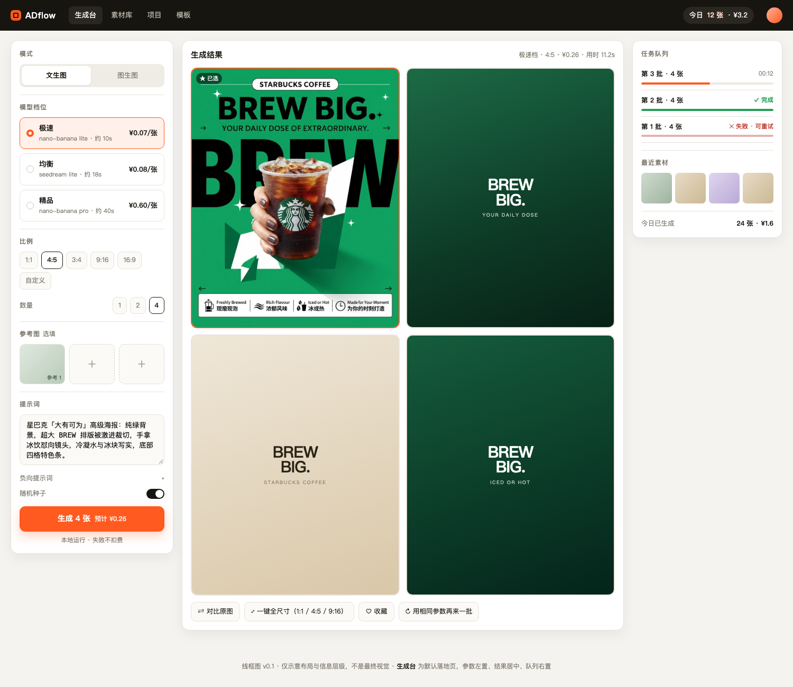
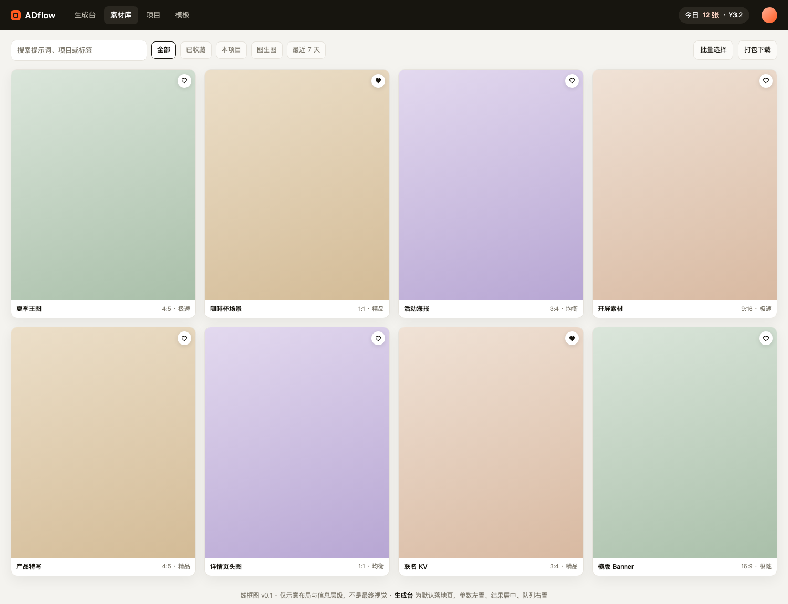
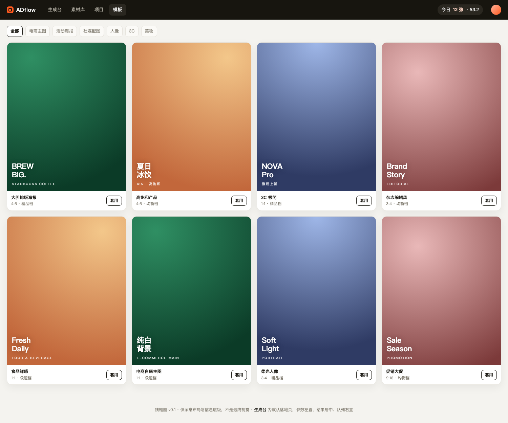

# ADflow 产品设计 v0.2 · 个人版

> AI 图片生成工作台 · 文生图 / 图生图 / 局部重绘 / 扩图 / 批量套版
> 定位：**一个人的生产线**，自用、本地优先、无支付、无账号体系
> 状态：P0 + 部分 P1 已落地（见 [README](../README.md) 与 [CHANGELOG](CHANGELOG.md)）｜ 更新：2026-10-28

---

## 0. 相对 v0.1 的修订

v0.1 是按 SaaS 设计的。确认「自己用 + 没有支付」之后，砍掉这些：

| 砍掉 | 原因 |
|---|---|
| 注册/登录/找回密码 | 单用户，最多一个访问口令 |
| 积分、钱包、流水、充值、套餐 | 没有支付，直接记上游成本 |
| 团队空间、成员权限 | 一个人用 |
| 内容审核后台、人工复核 | 由上游模型自带审核兜底 |
| 多租户数据隔离、OSS/CDN | 本地 SQLite + 磁盘足够 |
| Prompt 社区、模板运营后台 | 模板直接写在配置文件里 |

保留并强化的：

- **可复现**：每次生成的所有参数、种子、模型、上游任务 ID 全存，一键再来一批
- **成本透明**：每张图花多少钱、这个月花了多少，实时可见
- **零打断**：生成中可以继续调参、继续提交
- **本地优先**：数据和图片都在自己机器上，随时可备份

---

## 1. 一句话

> 把我每天重复的「想词 → 出图 → 挑图 → 改尺寸 → 存下来」压缩成一条流水线。

不是产品，是**提高自己出图效率的工具**。判断标准只有一条：**每周省下多少时间 / 多出多少可用图**。

---

## 2. 谁在用、怎么用

就一个人：偶尔要给商品、自媒体、客户做图。典型一天：

- 早上：给新品出 4 张主图候选，挑 1 张精修
- 下午：同一张图要 1:1 / 4:5 / 9:16 三个版本
- 晚上：翻出上周的参数，换文案再来一批

所以真正高频的不是"生成"，是**生成之后的那串操作**：挑图、改尺寸、复用参数、找历史图。

---

## 3. 设计原则（个人版）

1. **先出图，再谈整理**：任何操作都能从一张图直接长出来（重绘、变体、改尺寸、存项目）。
2. **参数永不丢**：每个结果都能还原成"怎么生成的"，包括当时用的模型版本。
3. **价格看得见**：按钮上写清楚这一下多少钱，月底有账。
4. **不锁界面**：生成是异步的，等待期间可以继续干活。
5. **数据是自己的**：一个 SQLite 文件 + 一个图片目录，拷走就能迁移。
6. **不为低频需求做抽象**：不做插件系统、不做权限、不做多语言。

---

## 4. 功能范围

### 4.1 P0（第一版就要有，约 1 周）

| 模块 | 内容 |
|---|---|
| 生成台 | 文生图、图生图（1–4 张参考图）、比例、数量、种子、负向提示 |
| 模型 | 档位预设（快/均衡/精）+ 高级模式直接选模型 |
| 任务 | 异步队列、进度、失败重试、历史任务 |
| 结果 | 2×2 网格、大图查看、下载、再来一批 |
| 素材库 | 全部结果、按项目/模型/日期筛选、赞、删除、搜索 prompt |
| 成本 | 每次生成记录上游花费，今日/本月汇总 |
| 预设 | 把常用参数存成预设（模型+比例+数量+负向词） |
| 存储 | 图片落本地，缩略图自动生成，重复生成不覆盖 |

### 4.2 P1（用起来之后自然会要）

- **局部重绘**：画刷遮罩，只重画选区
- **扩图**：按比例往外扩画布
- **批量尺寸**：一张图一键出 1:1 / 4:5 / 9:16 / 16:9
- **模板**：prompt + 参数预设 + 示例图，点一下就填好
- **对比视图**：原图与结果滑动对比
- **Prompt 片段库**：常用风格/光线/构图片段，点一下插入
- **多模型对撞**：同一 prompt 同时跑 2–3 个模型，并排挑

### 4.3 P2（想要再说）

- 批量任务（CSV 导入 prompt 列表）
- 本地 API（给自己其他脚本调）
- 视频生成（复用同一任务系统）
- 自动打标签 / 以图搜图

### 4.4 明确不做

- 账号、支付、订阅
- 团队协作、分享链接（本机用不上）
- 图库交易、社区
- 复杂图层编辑器（不替代 PS）

---

## 5. 信息架构

```
ADflow（本地 http://localhost:3000）
├── 生成台 /create        默认首页：参数 + 结果 + 队列
├── 素材库 /library       全部图片，筛选/赞/搜索
├── 项目   /projects      按用途分组（可选，不强制）
├── 模板   /templates     prompt 预设，一键套用
├── 任务   /tasks         历史与失败重试
└── 设置   /settings      模型开关、成本、存储、备份
```

没有「额度」页——成本折在生成台和设置里，不单独占导航。

---

## 6. 核心流程

### 6.1 生成

```
写 prompt（或套模板）
  → 选比例/数量/档位（按钮实时显示预计花费）
  → 生成 → 入队 → 提交上游 → 轮询
      ├─ 成功：落本地 + 缩略图 + 记录成本 → 展示 4 张
      └─ 失败：自动重试 1 次 → 仍失败标红，可手动重试（不重复计费记录）
```

### 6.2 图生图

```
拖入/粘贴图片 → 自动压缩到长边 2048、清 EXIF、生成缩略图
  → 选模式：整图重绘（强度滑杆）/ 局部重绘（画刷）/ 扩图（拖边界）
  → prompt 自动补一句「保留主体结构」
  → 生成后与原图滑动对比
```

### 6.3 一次生成之后（高频操作链）

```
挑图 → 下载单张 / 下载全部 / 改尺寸 / 重绘 / 生成变体 / 存项目 / 赞
```

> 这条链决定产品好不好用，优先级高于任何新模型。

---

## 7. 页面设计

### 7.1 生成台 `/create`



三栏：参数 308px / 结果自适应 / 队列 284px。

**参数栏**

- 模式切换：文生图 / 图生图
- 档位：极速 / 均衡 / 精品，直接标预计单价（¥），hover 显示模型名与预估耗时
- 比例：1:1、4:5、3:4、9:16、16:9、自定义
- 数量：1 / 2 / 4
- 参考图：三个槽位，支持拖拽、粘贴、URL
- 提示词：textarea，支持 `⌘↵` 直接生成；下方折叠负向提示与种子
- 预设：右上角「存为预设」，下次一键回填
- 生成按钮：`生成 4 张 · 预计 ¥0.26`

**结果区**

- 2×2 网格；选中卡片描边高亮
- hover 浮出：下载 / 放大 / 重绘 / 变体
- 底部工具条：对比原图、一键全尺寸、赞、再来一批

**队列**

- 进行中任务显示用时与进度；失败任务标红并可重试
- 最近 8 张缩略图 + 今日统计（张数 / 花费）

**状态设计**

| 状态 | 表现 |
|---|---|
| 生成中 | 骨架卡 + 进度条 + 计时，不阻塞其他操作 |
| 部分失败 | 成功的照常展示，失败的卡片单独标红可重试 |
| 全部失败 | 顶部条：失败原因（人话）+ 一键重试 |
| 预算提醒 | 超过本月预算时顶部黄条提示，但不拦（自用不硬锁） |
| 离线 | 任务卡标「连接中断」，恢复后自动续查 |

### 7.2 大图 / 轻编辑

- 左图右信息：prompt、模型、比例、种子、耗时、花费、生成时间
- 操作：下载、全尺寸、局部重绘、扩图、变体、复制参数
- 图生图场景默认开启「原图对比」滑条
- 重绘画刷：5–80px、撤销、清除；遮罩红色半透明

### 7.3 素材库 `/library`



- 4 列网格（>1200px），卡片 hover 显示模型/尺寸/时间
- 顶部：搜索 prompt、筛选（项目 / 模型 / 日期 / 赞 / 文生或图生）
- 多选：打包下载 zip、移入项目、删除
- 点开进大图页，参数可「复现」

### 7.4 模板 `/templates`



- 卡片 = 示例图 + 名称 + 比例 + 档位 + 「套用」
- 套用后回生成台，自动填好 prompt、比例、档位
- 模板存在 `config/templates.json`，改文件即生效，不做后台

### 7.5 任务 `/tasks`

- 表格：时间、类型、模型、参数摘要、耗时、花费、状态、操作
- 失败可展开看上游返回的错误码（翻译成人话）
- 支持「清空已完成」和按状态筛选

### 7.6 设置 `/settings`

- **模型**：每个模型的开关、默认档位映射、单价（用于成本计算）
- **成本**：本月花费、按模型统计、预算提醒阈值
- **存储**：数据目录、图片占用、清理 30 天前的临时图
- **备份**：一键导出 zip（数据库 + 图片）、恢复说明
- **高级**：上游 Base URL、并发数（默认 2）、默认水印开关

---

## 8. 模型与参数

### 8.1 抽象参数

前端只暴露：**比例、数量、清晰度（标准/高清）、强度（图生图）**，其余由适配层翻译。

```jsonc
{
  "mode": "text2img | img2img | inpaint | outpaint",
  "model": "fast | balanced | pro | <具体模型 id>",
  "prompt": "…",
  "negative": "…",
  "images": ["local://…"],     // 1–4
  "mask": "local://…",         // inpaint
  "aspect_ratio": "4:5",
  "n": 4,
  "seed": null,
  "strength": 0.55,
  "client_request_id": "uuid"
}
```

### 8.2 档位映射（初始配置）

| 档位 | 模型 | 上游单价 | 单张成本 |
|---|---|---|---|
| 极速 | `nano-banana-2-lite/image-to-image/economy` | $0.009 | ≈ ¥0.065 |
| 均衡 | `seedream-v5-lite/image-to-image` | ≈ $0.01 | ≈ ¥0.072 |
| 精品 | `nano-banana-pro/edit/stable` | ≈ $0.03–0.12 | ¥0.2–0.9 |

成本按实时汇率换算（默认 1 USD = 7.2 CNY，设置里可改）。

### 8.3 参数差异（适配层负责）

| 模型族 | 比例 | 清晰度 | 备注 |
|---|---|---|---|
| nano-banana | `aspectRatio` | 不支持 | 不传 resolution |
| gpt-image | 由 `size` 推导 | `size` 档位 | 只支持固定尺寸 |
| seedream | `aspectRatio` | `resolution` 1k/2k | 支持 watermark |
| flux | 宽高 | 宽高 | steps/guidance |

翻译不了就降级忽略，并在结果卡片上标注「该模型不支持此参数」。

---

## 9. 技术方案

### 9.1 架构（个人版，尽量少零件）

```
浏览器
  │
Next.js 15 (App Router, TypeScript)
  ├─ 页面（RSC + 客户端交互）
  ├─ Route Handlers（/api/*）
  └─ 进程内任务队列（并发 2，轮询上游）
        │
   SQLite (drizzle-orm)        本地磁盘 ./data/images
        │
   RunningHub OpenAPI
```

- **没有 Redis**：队列就是 `generations` 表 + 内存调度器；重启后扫描未完成任务继续轮询。
- **没有 OSS**：图片存 `./data/images/YYYY/MM/`，Next 路由 `/api/files/[...path]` 带缓存头输出。
- **没有对象存储/CDN**：本机访问，静态文件直接给。
- **没有登录**：默认 localhost 免登录；若绑 0.0.0.0，用 `ACCESS_TOKEN` 环境变量加一道口令。

### 9.2 队列设计

- 表驱动：`generations.status = queued | running | succeeded | failed`。
- 提交即预检：同一 `client_request_id` 已存在则直接返回，避免重复扣费。
- 轮询：5s 一次，指数退避到 15s；超过 30 分钟标 timeout，后台继续查 10 分钟，成功则补发。
- 失败重试：仅网络错误/5xx 重试 1 次；业务失败不重试。
- 进程重启恢复：启动时把 `running` 且超过 10 分钟的任务标为 `unknown`，重新查询上游。

### 9.3 数据模型

| 表 | 字段 |
|---|---|
| `generations` | id, mode, model_key, prompt, negative, params(json), status, cost_usd, upstream_task_id, client_request_id(unique), error, created_at, finished_at |
| `assets` | id, generation_id, path, thumb_path, width, height, bytes, seed, favorite, project_id, deleted_at |
| `projects` | id, name, cover_asset_id, created_at |
| `presets` | id, name, model_key, aspect_ratio, n, negative, prompt_prefix |
| `settings` | key, value（汇率、预算、并发、默认档位） |

> 图片文件不存 blob，只存相对路径；删记录时图片进 `./data/trash/`，7 天后清理。

### 9.4 关键接口

```
POST /api/generate            → { id, estimatedCost }
GET  /api/generations/:id     → { status, assets[] }
POST /api/generations/:id/retry
GET  /api/assets?q=&project=&model=&page=
POST /api/assets/:id/favorite
POST /api/assets/batch-download   → zip 流
POST /api/upload                  → { path, width, height }
GET  /api/stats?range=today|month → { count, cost }
GET  /api/settings  |  PATCH /api/settings
```

### 9.5 目录结构（建议）

```
ADflow/
├── app/                 # 页面与 route handlers
│   ├── (main)/create|library|projects|templates|tasks|settings
│   └── api/
├── lib/
│   ├── models/          # 适配器：nano-banana.ts, gpt-image.ts, seedream.ts
│   ├── queue.ts         # 进程内调度
│   ├── db/              # drizzle schema + migrate
│   └── storage.ts       # 落盘、缩略图、清理
├── data/                # sqlite + images（git 忽略）
├── config/templates.json
└── scripts/worker.ts    # 可选：独立进程跑队列
```

---

## 10. 成本与预算

- 每次生成记录 `cost_usd`，按设置里的汇率显示人民币。
- 生成台右上角：「今日 12 张 · ¥3.2」
- 设置页：本月合计、按模型分布、日均
- 预算提醒：超过阈值顶部黄条，只提醒不拦截（自用）。

---

## 11. 安全与合规

自用场景，够用即可：

- 只监听 localhost；需要局域网访问时用 `ACCESS_TOKEN` 简单口令
- 上传校验：magic bytes、≤20MB、长边 ≤4096、清 EXIF
- 上游 API Key 只放 `.env`，不进日志、不进前端
- 内容：模型自带审核，失败时展示上游原因；不做自建审核
- 生成图默认不带水印（自己用）；需要投放时可在设置里开

---

## 12. 非功能

| 指标 | 目标 |
|---|---|
| 首屏 | < 1s（本地） |
| 提交到出首图 | 极速 p95 < 20s |
| 同时任务 | 2 个在跑，其余排队 |
| 磁盘 | 单图 < 3MB；设置页显示占用，可一键清理 |
| 数据安全 | 每日自动备份 sqlite 到 `./data/backups/`，保留 7 份 |

---

## 13. 指标（只看效率）

- 每周出图数 / 可用图数（手动标记「可用」）
- 平均从写到下载的耗时
- 参数复用率（用预设或「再来一批」的比例）
- 单张平均成本

不追 DAU、不追留存——自己用得爽就是唯一指标。

---

## 14. 里程碑

| 阶段 | 周期 | 内容 | 验收 |
|---|---|---|---|
| M0 骨架 | 1 天 | Next 脚手架、SQLite、上传、一个模型的完整链路 | 命令行能出图并落盘 |
| M1 可用 | 5–7 天 | 生成台、队列、结果、素材库、成本、presets | 能替代现在的手工脚本 |
| M2 顺手 | 5 天 | 局部重绘、扩图、全尺寸、模板、对比视图 | 改图不用再开 PS |
| M3 打磨 | 按需 | 视频、批量 CSV、本地 API | — |

---

## 15. 风险与取舍

1. **上游单点**：RunningHub 挂了就没图 → 适配层留第二家（OpenAI/火山），但未必要先做。
2. **磁盘增长**：每天 50 张 × 2MB = 100MB/月 → 自动清理 + 手动归档。
3. **无备份**：本地磁盘即全部数据 → 每日备份文件夹，重要项目手动导出 zip。
4. **过度工程**：单人项目最怕做成 SaaS → 任何需要"角色/权限/流程"的需求直接砍。

---

## 附：原型

- 可交互线框图：[wireframe.html](wireframe.html)
- 截图：[生成台](screens/create.png) · [素材库](screens/library.png) · [模板](screens/templates.png)
